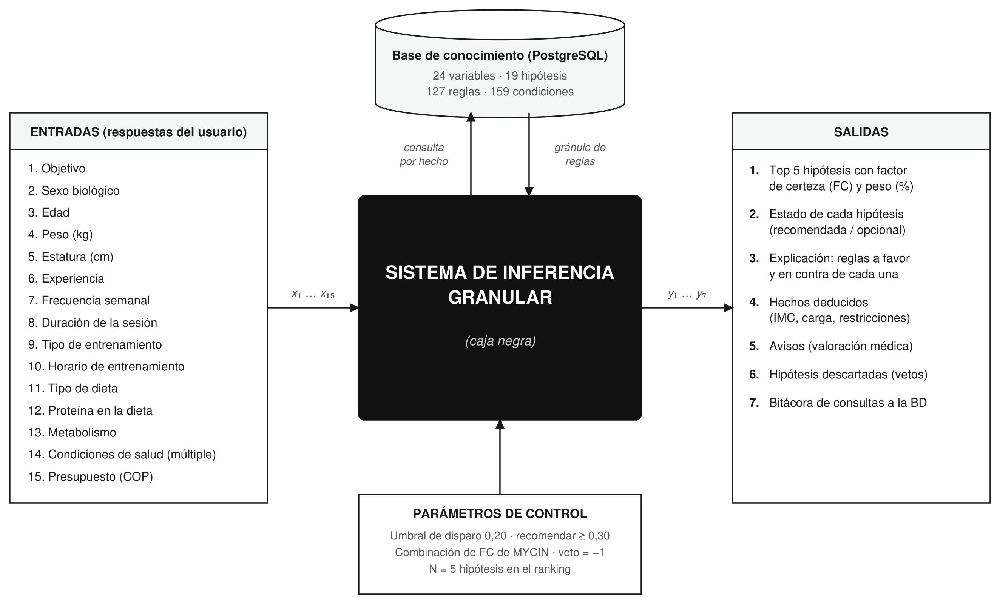
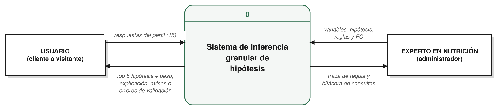
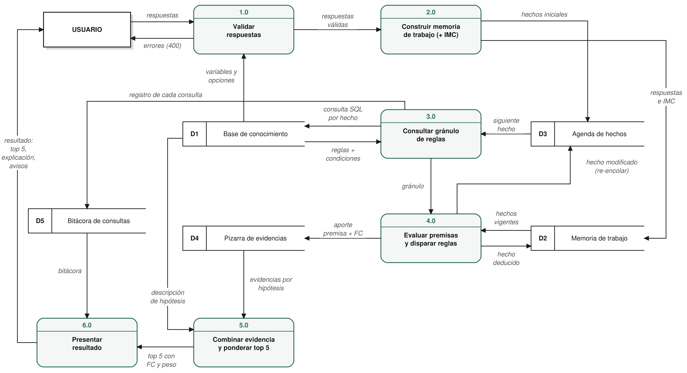
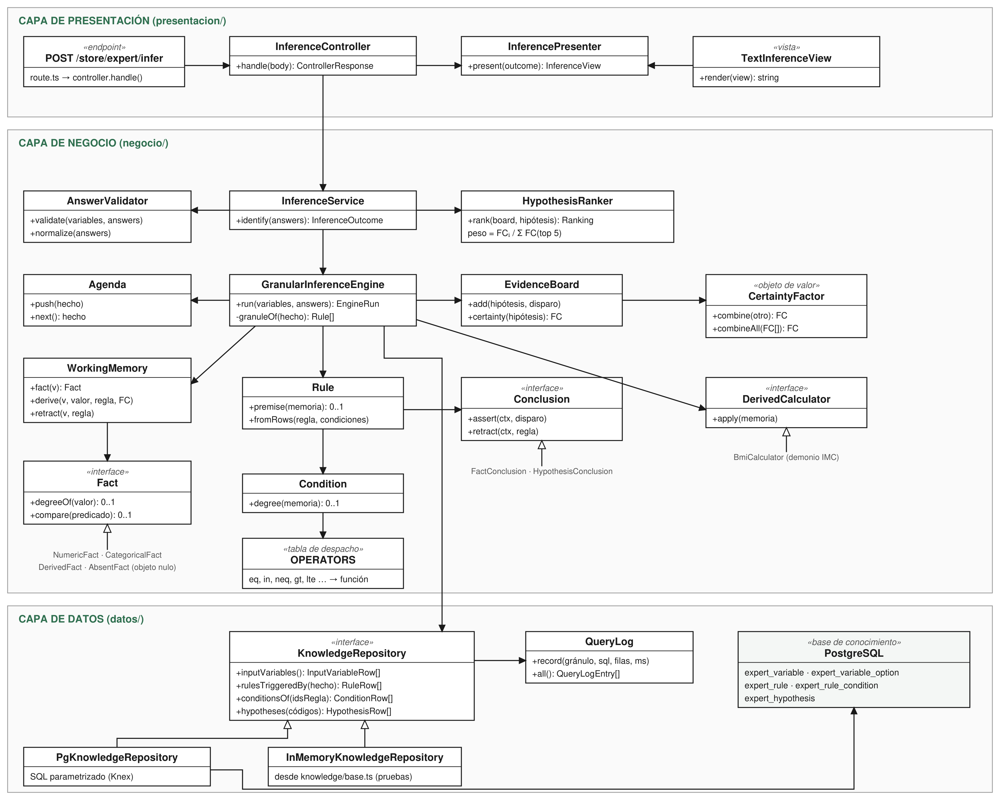

# Sistema de inferencia granular — Level Fitness

Diseño e implementación del sistema de inferencia del sistema experto de recomendación de suplementos de [Level Fitness](https://www.levelfitness.co). A partir de las respuestas del usuario, el sistema identifica las **5 hipótesis** (familias de producto) más probables con su **peso probabilístico**, consultando la base de conocimiento **de forma granular y sucesiva**: cada hecho conocido o deducido provoca una consulta a PostgreSQL que trae solo las reglas que lo mencionan. El conocimiento vive en la base de datos, no en condicionales del código.

**Entregables**

1. [Diagrama de caja negra](#1-diagrama-de-caja-negra)
2. [Diagrama de flujo de datos (niveles 0 y 1)](#2-diagrama-de-flujo-de-datos)
3. [Código fuente orientado a objetos en tres capas](#3-código-fuente-oo-en-tres-capas)

---

## 1. Diagrama de caja negra



**Entradas (15):** objetivo, sexo, edad, peso, estatura, experiencia, frecuencia semanal, duración de la sesión, tipo de entrenamiento, horario, dieta, proteína en la dieta, metabolismo, condiciones de salud y presupuesto.

**Salidas (7):** top 5 de hipótesis con factor de certeza y peso, estado de cada una, explicación (reglas a favor y en contra), hechos deducidos, avisos, hipótesis descartadas y bitácora de consultas a la base de datos.

## 2. Diagrama de flujo de datos

Notación de Gane y Sarson: entidades externas (rectángulo con sombra), procesos (rectángulo redondeado numerado) y almacenes (rectángulo abierto).

### Nivel 0 — contexto



### Nivel 1 — procesos del sistema de inferencia



El ciclo central es **3.0 → 4.0 → D3 → 3.0**: cada hecho que sale de la agenda genera una consulta granular a la base de conocimiento (D1), las reglas del gránulo se evalúan contra la memoria de trabajo (D2) y los hechos deducidos vuelven a la agenda (D3) para provocar nuevas consultas.

| Proceso | Descripción | Clase que lo implementa |
| --- | --- | --- |
| 1.0 Validar respuestas | Comprueba respuestas, valores y rangos contra las variables de la BD | `AnswerValidator` |
| 2.0 Construir memoria de trabajo | Convierte respuestas en hechos y calcula el IMC | `WorkingMemory`, `BmiCalculator` |
| 3.0 Consultar gránulo de reglas | Consulta a la BD las reglas que mencionan el hecho actual y sus condiciones | `GranularInferenceEngine`, `PgKnowledgeRepository` |
| 4.0 Evaluar premisas y disparar reglas | Afirma o retira conclusiones y re-encola los hechos que cambian | `Rule`, `Condition`, `Conclusion` |
| 5.0 Combinar evidencia y ponderar | Combina factores de certeza (MYCIN) y pondera el top 5 | `EvidenceBoard`, `HypothesisRanker` |
| 6.0 Presentar resultado | Construye la respuesta JSON o de texto | `InferencePresenter`, `TextInferenceView` |

| Almacén | Contenido | Implementación |
| --- | --- | --- |
| D1 Base de conocimiento | Variables, opciones, hipótesis, reglas y condiciones | Tablas `expert_*` en PostgreSQL ([esquema](base-de-datos/modelo-relacional.sql)) |
| D2 Memoria de trabajo | Hechos del usuario, calculados y deducidos con su certeza | `WorkingMemory` |
| D3 Agenda de hechos | Hechos pendientes de consultar | `Agenda` |
| D4 Pizarra de evidencias | Aporte vigente de cada regla a cada hipótesis | `EvidenceBoard` |
| D5 Bitácora de consultas | Gránulo pedido, sentencia, filas y tiempo | `QueryLog` |

## 3. Código fuente OO en tres capas



Las dependencias van en un solo sentido: **presentación → negocio → datos**. El negocio depende de la interfaz `KnowledgeRepository`, no de PostgreSQL, por eso el mismo código corre sobre la base real o sobre memoria.

```
src/
├── api/store/expert/infer/route.ts         Endpoint POST /store/expert/infer (Medusa v2)
├── modules/expert/
│   ├── inference/
│   │   ├── presentacion/                   CAPA DE PRESENTACIÓN
│   │   │   ├── inference-controller.ts     Recibe la petición, delega y traduce errores a 400
│   │   │   ├── inference-presenter.ts      Resultado de negocio → modelo de vista
│   │   │   └── text-view.ts                Vista de texto (consola)
│   │   ├── negocio/                        CAPA DE NEGOCIO
│   │   │   ├── inference-service.ts        Caso de uso: validar → inferir → rankear
│   │   │   ├── inference-engine.ts         Encadenamiento hacia adelante dirigido por agenda
│   │   │   ├── agenda.ts                   Cola de hechos pendientes de consultar
│   │   │   ├── working-memory.ts           Memoria de trabajo
│   │   │   ├── facts.ts                    Hechos numéricos, categóricos, deducidos y ausente (objeto nulo)
│   │   │   ├── rule.ts                     Regla (gránulo), condición y conclusión polimórfica
│   │   │   ├── operators.ts                Tabla de despacho de operadores (eq, in, neq, gt…)
│   │   │   ├── evidence-board.ts           Pizarra de evidencias por hipótesis
│   │   │   ├── certainty-factor.ts         Factor de certeza y combinación MYCIN
│   │   │   ├── hypothesis-ranker.ts        Umbrales, top 5 y peso probabilístico
│   │   │   ├── answer-validator.ts         Validación de respuestas con datos de la BD
│   │   │   └── derived-calculators.ts      Demonio IMC
│   │   ├── datos/                          CAPA DE DATOS
│   │   │   ├── knowledge-repository.ts     Contrato de las 4 consultas granulares
│   │   │   ├── pg-knowledge-repository.ts  SQL parametrizado sobre PostgreSQL
│   │   │   ├── in-memory-knowledge-repository.ts  Implementación en memoria (pruebas)
│   │   │   └── query-log.ts                Bitácora de consultas sucesivas
│   │   └── index.ts                        Raíz de composición (arma las 3 capas en Medusa)
│   ├── engine.ts                           Motor original: combinación de FC y umbrales que se reutilizan
│   └── knowledge/base.ts                   Conocimiento del experto: 24 variables, 19 hipótesis, 127 reglas
└── scripts/demo-inferencia.ts              Demostración contra PostgreSQL (dentro del backend)
demo/demo.ts                                Demostración sin base de datos
base-de-datos/modelo-relacional.sql         Esquema de la base de conocimiento (PostgreSQL 16)
diagramas/                                  Diagramas en PNG y SVG
```

### Por qué no es un sistema de condicionales

- El motor no contiene ningún valor del dominio (no sabe qué es la creatina ni el embarazo): las reglas llegan como filas de la base de datos.
- El operador de cada condición se resuelve en una **tabla de despacho** (`operators.ts`), no en un `switch`.
- Los hechos y las conclusiones son **polimórficos**: el motor les pide su grado o que se afirmen sin preguntar de qué tipo son.
- El camino de la inferencia depende de lo que se va deduciendo: un hecho deducido (por ejemplo, *evitar estimulantes*) genera una consulta que no existía al comienzo.
- Si el experto agrega o cambia una regla en la base de datos, la siguiente consulta la usa sin modificar el código.

### Las consultas granulares

| Consulta | Método | Pregunta que responde |
| --- | --- | --- |
| Q1 | `inputVariables()` | ¿Qué atributos describen al usuario y qué valores admiten? |
| Q2 | `rulesTriggeredBy(hecho)` | ¿Qué reglas mencionan este hecho en su premisa? |
| Q3 | `conditionsOf(idsRegla)` | ¿Cuáles son las condiciones de esas reglas (solo las aún no vistas)? |
| Q4 | `hypotheses(códigos)` | ¿Qué significan las hipótesis que reunieron evidencia? |

Q2 y Q3 se repiten por cada hecho que sale de la agenda.

## Peso probabilístico

Cada regla aporta evidencia con un factor de certeza (FC) en la escala de MYCIN (−1 a 1); el aporte es *grado de la premisa × FC*. Los aportes a una misma hipótesis se combinan con las funciones de Shortliffe y Buchanan (1975):

```
FC(a, b) = a + b(1 − a)                    si a ≥ 0 y b ≥ 0
FC(a, b) = a + b(1 + a)                    si a < 0 y b < 0
FC(a, b) = (a + b) / (1 − min(|a|, |b|))   si tienen signos distintos
FC(a, b) = −1                              si a = −1 o b = −1  (veto)
```

Las cinco hipótesis de producto con mayor FC positivo reciben un peso normalizado, de modo que suman 100 %:

```
P(hᵢ) = FCᵢ / (FC₁ + FC₂ + FC₃ + FC₄ + FC₅)
```

**Ejemplo** (mujer, 34 años, 78 kg, bajar grasa, 5 días por semana, entrena de noche, proteína baja en la dieta), resuelto con 44 consultas sucesivas en 23 ciclos de agenda:

| Puesto | Hipótesis | FC | Peso |
| --- | --- | --- | --- |
| 1 | Proteína whey | 0,739 | 23,4 % |
| 2 | L-carnitina | 0,648 | 20,5 % |
| 3 | Magnesio y adaptógenos para el descanso | 0,610 | 19,3 % |
| 4 | Multivitamínico | 0,610 | 19,3 % |
| 5 | Aminoácidos (BCAA / EAA) | 0,550 | 17,4 % |

Proteína whey: R01 aporta 0,525 (la necesidad proteica deducida por RF30 con certeza 0,7 × FC 0,75) y R04 aporta 0,45, así que FC = 0,525 + 0,45 × (1 − 0,525) = 0,739 y su peso es 0,739 / 3,157 = 23,4 %.

## Ejecutar la demostración

Requiere Node.js 18 o superior. No necesita base de datos: usa el repositorio en memoria con el mismo conocimiento.

```bash
npm install
npm run demo                  # perfil de ejemplo, vista de texto
npm run demo -- --json        # modelo de vista JSON completo
npm run demo -- perfil.json   # perfil propio
```

Ejemplo de `perfil.json`:

```json
{
  "objetivo": "ganar_masa", "sexo": "hombre", "edad": 28, "peso": 72, "estatura": 175,
  "experiencia": "intermedio", "frecuencia": 4, "duracion": 60, "tipo_entrenamiento": "fuerza",
  "horario": "tarde", "dieta": "omnivora", "proteina_dieta": "adecuada", "metabolismo": "normal",
  "salud": ["ninguna"], "presupuesto": 500000
}
```

En el backend de la tienda (Medusa v2 + PostgreSQL) el mismo código atiende `POST /store/expert/infer` con el cuerpo `{ "answers": { … } }` y responde 400 si faltan respuestas o hay valores inválidos.

## Validación

El sistema granular se comparó con el motor original del sistema experto en las 31 ramas del árbol de decisión: los factores de certeza de las 19 hipótesis coinciden exactamente en todas las ramas.
